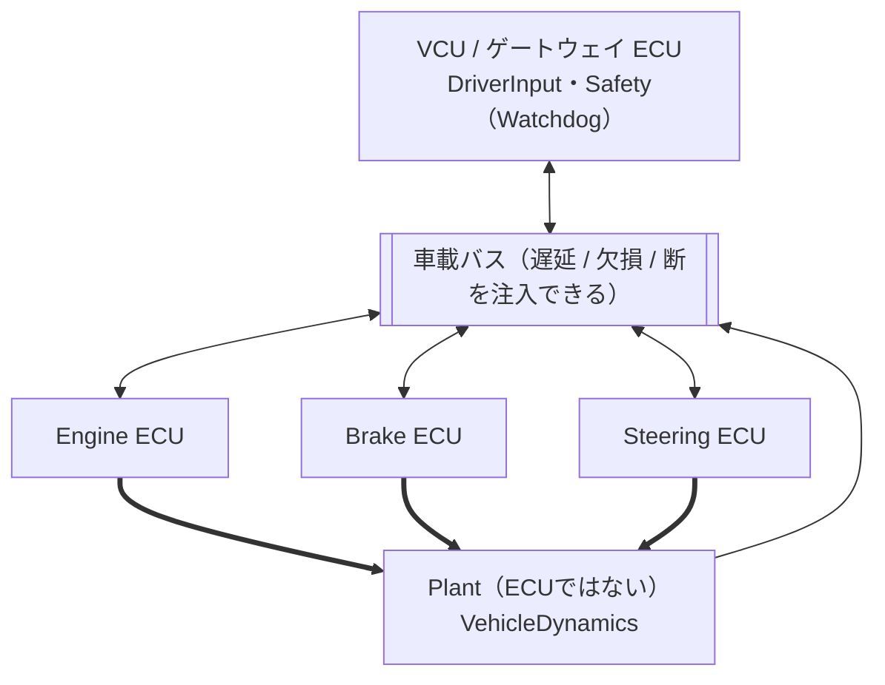

# SDV Playground (AUTOSAR-like)

本プロジェクトは、個人開発で「SDV（Software-Defined Vehicle）を自作していく」ための最小アーキテクチャと実装ベースを提供します。  
最終的にはRCカー相当の構造へ載せ替え可能な設計とし、初期は完全シミュレータ（2D）で開発・検証します。

実装は 2 つあります。

| | 役割 | 場所 |
|---|---|---|
| **C++** | 参照実装（1 プロセス・1 RTE）。基準ログの生成元 | `src/`、`tests/` |
| **Rust** | 主役。ECU ごとの RTE + 仮想バス、Watchdog / フェイルセーフ、Config / NVM、シナリオ。WASM にしてブラウザで動かす | `rust/sdv-core/` |

ブラウザで動くシミュレータ（GUI）は `web/` にあり、GitHub Pages で公開されます（下記）。

## 目的

- AUTOSAR（Classic寄り）を参考に、以下の構造を最小限で成立させる
  - SWC（アプリケーション部品）分割
  - RTE相当の信号I/F固定（Read/Write）
  - BSW相当（時間基盤、通信、NVM、診断/監視、ログ）
- “細かく”段階を刻みながら、部品単体→統合→SDV化（更新/監視/ログ/分割）へ到達する

## 最初のスコープ（v1）

- シミュレータ（2D）で「アクセル/ブレーキ/ハンドル」で車が動く
- 車輪回転（wheel_omega）を模擬してログに出る
- E-Stop（安全停止）が必ず効く
- パラメータ更新（Config/NVM）で挙動が変わる（例：最大速度、最大舵角、最大減速度）
- 同一入力でリプレイできる（ログ再現性）

達成状況（Rust 実装）: E-Stop・Watchdog、Config/NVM（更新・ロールバック・破損復旧）、シナリオによる再現性は実装済み。詳細な進捗は [docs/design/00_overview.md](docs/design/00_overview.md)。

## アーキテクチャ概要（AUTOSAR-like）

- Application Layer（SWC）
  - DriverInputSWC / EngineSWC / BrakeSWC / SteeringSWC / VehicleDynamicsSWC / SafetySupervisorSWC
- RTE
  - Rte_Read / Rte_Write と Runnable 呼び出し（手書き最小実装）。Rust 実装では **ECU ごとに 1 つ**
- BSW
  - TimeBase / Com（仮想バス）/ Nvm(Config) / Diag+Watchdog / Logging
- Platform
  - 依存（OS、I/O、時刻、ファイル等）の抽象化

Rust 実装の ECU 構成（ADR-0002）:



詳しい図（実行順序・Watchdog・Config/NVM など）は [docs/design/07_ecu_architecture.md](docs/design/07_ecu_architecture.md)。

## ブラウザで動かす（GUI）

`web/` に、Rust を WebAssembly にしたシミュレータがあります。サーバー不要で、アクセル・ブレーキ・ステアリング操作、ECU 構成図からの故障注入（SWC 停止・バス遅延/欠損/断・VCU 停止）、Config/NVM の編集・ロールバック、シナリオ（JSON）の再生ができます。

- GitHub Pages で公開（`.github/workflows/pages.yml`）。公開 URL は Settings → Pages で確認（`https://<ユーザー名>.github.io/SDV/` の想定）。初回のみ Source を **GitHub Actions** に設定
- ローカルで試す手順は [web/README.md](web/README.md)

## リポジトリ構成

```
src/        C++ 参照実装（app / bsw / model / rte / swc）
tests/      C++ 単体テスト（Catch2）
rust/       Rust 実装（sdv-core: シミュレータ本体 / sdv-sec: 署名・MAC などの通信の基礎ライブラリ）。WASM にして web/ から使う
web/        ブラウザ GUI（HTML + JS）
docs/       設計文書（design/）と設計判断（adr/）
tasks/      実装タスクの記録（SWC ごと）
tools/      可視化などの補助スクリプト（Python）
```

## ドキュメント

- [docs/design/00_overview.md](docs/design/00_overview.md) : 全体方針、用語、進捗管理
- [docs/design/01_architecture.md](docs/design/01_architecture.md) : 全体設計（層、データフロー）
- [docs/design/02_interfaces_signals.md](docs/design/02_interfaces_signals.md) : 信号I/F定義
- [docs/design/03_components.md](docs/design/03_components.md) : 部品設計（SWC/BSW/RTE）
- [docs/design/04_tasks_scheduling.md](docs/design/04_tasks_scheduling.md) : タスク設計（周期、順序）
- [docs/design/05_safety_logging_update.md](docs/design/05_safety_logging_update.md) : 安全/ログ/更新設計
- [docs/design/06_roadmap_dod.md](docs/design/06_roadmap_dod.md) : 作成順序、成果物、完成条件（DoD）
- [docs/design/07_ecu_architecture.md](docs/design/07_ecu_architecture.md) : ECU 構成・バス・Watchdog・Config/NVM・シナリオ（現行実装の図）
- [docs/adr/ADR-0001-autosar-like-architecture.md](docs/adr/ADR-0001-autosar-like-architecture.md) : AUTOSAR-like を採用
- [docs/adr/ADR-0002-ecu-partitioning.md](docs/adr/ADR-0002-ecu-partitioning.md) : 疑似 ECU 分割の方針
- [docs/adr/ADR-0003-config-nvm.md](docs/adr/ADR-0003-config-nvm.md) : Config / NVM（更新とロールバック）
- [docs/adr/ADR-0005-fota.md](docs/adr/ADR-0005-fota.md) : FOTA（ECU ソフトの更新・署名検証・試験適用・ロールバック）
- [docs/design/fota-pi5-operations.md](docs/design/fota-pi5-operations.md) : Pi 5 FOTA運用。positional launcherはvehicle root専用、ECU target-aware launchはactive slot専用
- [rust/README.md](rust/README.md) : Rust 実装の構成・WASM API
- [rust/sdv-sec/README.md](rust/sdv-sec/README.md) : 通信の基礎ライブラリ（SHA-256・Ed25519 検証・フレーム MAC、C ABI）
- [web/README.md](web/README.md) : ブラウザ GUI の使い方
- [CONTRIBUTING.md](CONTRIBUTING.md) : TDD の進め方、テスト、CI

進捗を追うときは、まず [docs/design/00_overview.md](docs/design/00_overview.md) を見て、詳細な完成条件は [docs/design/06_roadmap_dod.md](docs/design/06_roadmap_dod.md) を参照。

## 開発・テスト（TDD）

Rust / C++ / C の実装はすべてTDDで進めます。進め方、テスト実行方法、PRのOK条件（GitHub Actionsの `ci-ok` が緑）は [CONTRIBUTING.md](CONTRIBUTING.md) を参照。

## ビルド・実行

### C++（参照実装）

要件: CMake 3.20+、C++17

```bash
cmake -S . -B build
cmake --build build -j
ctest --test-dir build --output-on-failure   # 単体テスト
./build/sdv_sim                               # 10 秒のデモシナリオを実行
```

実行したディレクトリの `logs/latest.csv` にログが出ます（`logs/` は Git 管理外）。

故障注入（SWC を指定時刻から止める）:

```bash
./build/sdv_sim --stall steering:3 --stall brake:3.5   # 3.0 s に Steering、3.5 s に Brake が停止
```

### Rust

要件: Rust（stable）。WASM を作るなら `rustup target add wasm32-unknown-unknown`

```bash
cd rust/sdv-core
cargo test                                             # C++ の基準ログとの全行一致を含む
cargo build --release --target wasm32-unknown-unknown  # -> target/wasm32-unknown-unknown/release/sdv_core.wasm
```

C++ の出力を変えたとき、基準ログの更新手順は [CONTRIBUTING.md](CONTRIBUTING.md) を参照。

## データ可視化

シミュレーション実行後、Python 可視化ツールで結果をグラフ表示できます：

```bash
# 初回のみ：Python 仮想環境とパッケージをインストール
python3 -m venv venv_viz
source venv_viz/bin/activate
pip install matplotlib numpy

# 可視化実行（PNG/PDF 生成）
python3 tools/python/plot_integration_test.py
```

出力ファイル：
- `docs/test_reports/plots/engine_brake_integration_plot.png` (1967x1397px, 152KB)
- `docs/test_reports/plots/engine_brake_integration_plot.pdf` (37KB)

グラフ内容：
- 📊 ドライバー入力（アクセル・ブレーキ）
- ⚙️ アクチュエータコマンド（エンジン・ブレーキ）
- 🔗 相関分析（入出力の線形性確認）
- 🚗 車速の時間推移
- 🗺️ 車両軌跡（X-Y 平面）

## 開発の進め方（重要）

本PJは「最初に全部を作らない」方針です。

1. 骨格固定（Signals/RTE/TimeBase/Logging）
2. Engineのみ（加速と車輪回転）
3. Steeringのみ（ヨー更新）
4. Brakeのみ（減速）
5. 統合（縦→横→Pose）
6. SDV化（監視、更新、通信分割）— ECU 分割・Watchdog・Config/NVM・シナリオまで Rust で実装済み

設計判断はADRに残し、PRは小さく、動くものから順に出します（[CONTRIBUTING.md](CONTRIBUTING.md)）。

## ライセンス

- LICENSEを参照（MIT）
