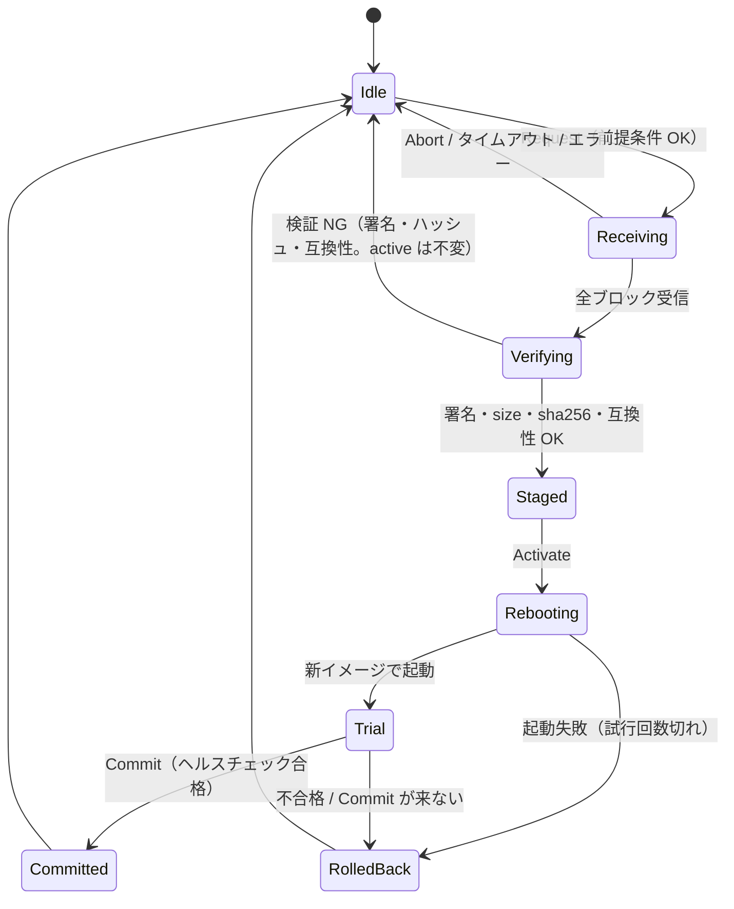

# ADR-0005: FOTA（ECU ソフトの更新・試験適用・ロールバック）

## Status

Accepted（2026-10-17）。下書きの「要確認事項」9 項目を決めた（末尾の「決定事項」）。**署名は段階1に入れ、署名・ハッシュ・MAC は通信の基礎ライブラリ `sdv-sec` として切り出す**（下書きの「署名は段階2」から変更）。

> 番号について: ADR-0003 改訂1 の「置き場所」で ADR-0004 を「C++/Rust の境界の整理」に予約しているため、本ADRは 0005 とした。入れ替える場合はファイル名とリンクを直す。

## Context

ADR-0003 で **Config（データ）の更新** は成立している（検証 → A/B 2面 + CRC32 → 再起動で有効 → ロールバック）。
本ADR作成時点では、SDV の要点である **ソフト（コード）の更新** は未着手で、`docs/design/05_safety_logging_update.md` の「v1+：SWC差し替え」に方針メモがあるだけだった。

### 実装状況（2026-10-26）

`rust/sdv-fota` に署名済み SDVF の固定メモリ検証、共通 A/B 更新状態機械、Pi 5/Linux のファイル backend、ホスト用 package signer/installer、HTTPS ingress、trial launcher が実装されている。Pi installer は root が管理する trust store の Ed25519 鍵だけを受け入れる。Linux launcher は root 所有のスロットとboot metadataを保持し、candidate image とhealth commandを別の非特権UID/GIDで起動する。署名→導入→trial起動→health check→commit/rollback はLinux統合テストで通している。固定メモリの `CampaignManager` は車両停止・Safety正常を条件に複数ECUを一台ずつ更新するコマンド列を制御するが、診断/CAN transportとVCUシミュレータへの接続は未実装。実Pi 5上の動作確認、実アプリのhealth check、VCU UpdateManager統合、採用 AUTOSAR Classic BSW/MCAL/Bootloader binding は未完了であり、この実装を量産FOTAやAUTOSAR準拠とは扱わない。

本ADRで、ECU に載るソフトを **配信 → 検証 → 書き込み → 試験適用 → 確定 or 自動ロールバック** する仕組み（FOTA）を設計する。
ADR-0002 で作った「ECU 分割・仮想バス・故障注入・Watchdog」が、そのまま FOTA の検証環境になる。

### 前提・制約（既存の決定との整合）

- **Safety（SafetySupervisorSWC）は更新対象外**（常駐。05 の方針）。Safety が載る VCU は、当面は更新対象にしない
- **既存の Watchdog は緩めない**。Alive 途絶 > 1000 ms で、1ECU → Degraded、2ECU 以上 → EStop（ラッチ）
- **基準ログ（golden）を壊さない**。更新を行わないシナリオでは、ログは従来と全行一致する
- 記憶装置は ADR-0003 の抽象（`read(slot)` / `write(slot, bytes)`）を再利用する。テストと WASM はメモリ上、ブラウザは localStorage
- 主役は Rust。C++ には反映しない（ADR-0002 と同じ）
- バスは CAN 風（固定周期フレーム）。大きなデータの転送には向かない（→ 更新チャネルを分ける）
- ADR-0003 は「署名付き更新・差分更新は非ゴール」としていた（Config 更新の話）。**FOTA では署名を必須にする**（決定 3）。差分更新は引き続き扱わない

### Config 更新との違い

| 観点 | Config 更新（ADR-0003） | FOTA（本ADR） |
| ---- | ----------------------- | ------------- |
| 対象 | JSON のパラメータ | ECU 上の SWC 実装 |
| 大きさ | 小さい（1 フレームで足りない程度） | 大きい（分割転送が必要） |
| 検証 | 構文・範囲 | **署名**・サイズ・ハッシュ・互換性（信号I/F、Config schema）・ダウングレード |
| 失敗の影響 | 値が不適切 | 起動しない・止まる |
| ロールバック | 手動（後続で自動） | **起動失敗・不合格・Commit なしで自動** |

## 検討した案

### イメージの実体

#### 案A: 論理イメージ（ビルド済みの複数バージョンから選ぶ）【推奨：最初に実装】

- SWC の実装を複数バージョン持っておき、manifest が「どの ECU のどの実装を、どのバージョンで有効にするか」を指す
- 転送するバイト列は実体のないペイロード（ハッシュ・サイズ・分割転送は本物）
- 配信、検証、A/B、試験適用、ロールバックといった **プロトコルと状態遷移を本物にできる**
- 既存 SWC のコードを変えず、golden も保てる。実装量は小〜中
- 弱点: 「コードが入れ替わる」実感は薄い

#### 案B: 実 WASM モジュール（ECU ごとに別モジュール）

- SWC を別の WASM にして、ECU が実行時に読み込む。ブラウザ上で本当にホットスワップできる
- ホスト側（ブラウザは WebAssembly API、`cargo test` は wasmtime など）が必要で、変更量が大きい。ADR-0004（境界の整理）と干渉しやすい

#### 案C: Config の拡張のみ

- Config にバージョンや署名を足すだけ。コードの更新にならないので、FOTA とは呼べない（不採用）

### 配信経路

- **案X: 制御バスに載せる** … 固定周期フレームの帯域を圧迫し、制御の周期（10 / 20 ms）に影響する
- **案Y: 更新チャネルを別に持つ**【推奨】 … 実車の診断/リプログラミング用チャネル（UDS over CAN-FD / DoIP）に相当する。帯域・遅延・欠損率を別に設定でき、バスの故障注入（遅延・欠損・断）も同じように効く

## Decision

1. **案A → 案B の順で進める。** 段階1で仕組みを固め、段階2（実 WASM 化）は別ADRで扱う
2. **配信経路は案Y（更新チャネル）。** 制御は既存のバスフレームで行い、データ本体は更新チャネルで送る
3. **更新の単位は「ECU ごとの SWC イメージ」。** 当面の対象は Engine / Brake / Steering の 3 ECU。VCU（Safety 同居）は対象外
4. **VCU に UpdateManager（更新の司令塔）を置く。** Safety SWC とは独立で、Safety の挙動を変えられない。外部（GUI、将来は Wi-Fi 経由のサーバ）からパッケージを受け取る
5. **A/B 2面 + ブート制御 + 試験適用。** 確定は「Commit が来たとき」だけ。Commit が来なければ ECU が自分で戻る
6. **更新は車両停止中に 1 ECU ずつ。** 2 ECU が同時に止まると EStop になるため
7. **Watchdog は緩めない。** ECU の再起動時間（`reboot_ms`）を `heartbeat_timeout_ms` より短く規定する
8. **イメージは署名必須。** SHA-256 でサイズ・破損を、Ed25519 の署名で出所・改ざんを検証する。検証の権威は **ECU 側**（VCU は信用しない）。秘密鍵は車に置かない
9. **暗号まわりは `sdv-sec` ライブラリにまとめる。** ハッシュ・署名検証・MAC（フレーム認証）を、FOTA とは独立した「通信の基礎」として提供する。暗号アルゴリズムは自作せず、実績のある実装（RustCrypto）を使う

## 仕様

### パッケージと manifest

```
{
  "manifest_schema": 1,
  "image": {
    "target_ecu": "steering",
    "swc": "SteeringSWC",
    "version": "1.1.0",
    "security_version": 3,
    "size_bytes": 12345,
    "sha256": "（16 進 64 文字）"
  },
  "requires": {
    "signal_if_version": 1,
    "config_schema": [1, 2]
  },
  "policy": {
    "allow_downgrade": false,
    "trial_ms": 5000
  }
}
```

- 未知の項目は拒否（ADR-0003 と同じ方針）。数値は有限値のみ
- `security_version`: 巻き戻し防止の単調増加の版。ECU は NVM に「これまでに受け入れた最大値」を持ち、**それ未満は署名が正しくても拒否**（`ROLLBACK_BLOCKED`）。`version` のダウングレード（決定 9）とは別物
- バージョンは `MAJOR.MINOR.PATCH`。現在より小さい（または同じ）バージョンは `allow_downgrade: false` なら拒否
- `signal_if_version`: 信号I/F（`02_interfaces_signals.md` とバスマトリクス）の版。**現状は版が無いので、定義する必要がある**（決定 7）
- `config_schema`: そのイメージが読める Config の schema（現行は 1 と 2）。NVM 内の Config と合わなければ拒否

### パッケージの構造と署名

```
package = { key_id, signature(64 B), manifest_bytes, payload }
```

- 署名の対象は **`manifest_bytes`（届いたバイト列そのもの）**。JSON を正規化して署名する方式は取らない（表記ゆれで検証が壊れるため）。**検証してから解析する**（署名 NG のバイト列は解析しない）
- `manifest` の `sha256` が `payload` を拘束するので、署名は payload 全体の出所・改ざんを保証する（受信後に `sha256` と突き合わせる）
- 署名方式は **Ed25519**（公開鍵 32 B、署名 64 B）。ハッシュは SHA-256。ECU が持つのは**公開鍵だけ**で、車が盗まれても偽の更新は作れない
- `key_id` が ECU の持つ信頼する公開鍵（trust anchor。最大 N 個）のどれかに一致しなければ `UNKNOWN_KEY`。鍵の追加・失効（ローテーション）は本ADRの対象外で、`key_id` の仕組みだけ先に用意する
- 検証は ECU の `Verifying` で行う。VCU も受信時に事前検証して早く失敗させてよいが、**確定判断は ECU が行う**（VCU が侵害されても不正なイメージは入らない）
- シミュレータの鍵: テスト・デモ用の鍵ペアをリポジトリに置く（**公開されたデモ鍵**で、本番の鍵ではない）。署名ツール（ホスト用 CLI）は秘密鍵を引数で受け取り、WASM / ECU 側のコードには**秘密鍵も署名の機能も入れない**。GUI の「デモ署名」は、デモ鍵でブラウザ上のホスト側コードが署名する（改ざん・別鍵・期限切れの注入で拒否を確認する用途）

### 通信ライブラリ `sdv-sec`

FOTA だけでなく、バスのフレーム認証にも使える土台にする。

| 機能 | 用途 | 備考 |
| ---- | ---- | ---- |
| `sha256` | 破損検知、manifest の `sha256` | |
| `ed25519_verify` | パッケージ・manifest の署名検証 | ECU 側。公開鍵のみ |
| `ed25519_sign`（ホスト専用の feature） | 署名ツール、テスト | **ECU 向けビルドには含めない** |
| `hmac_sha256` + 定数時間の比較 | フレーム認証（SecOC 風: データ + 鮮度カウンタ + 短縮 MAC） | 鍵は ECU ごとの NVM 領域 |
| 鮮度カウンタの検査 | リプレイ防止（受信側が「最後に受け入れた値」より大きいことを確認） | |

- `no_std`・ヒープなし・グローバル状態なし。入出力は**呼び出し側が渡すバッファ**で、時刻・ファイルを使わない（ADR-0004 で決める ECU ソフトの移植ルールと同じ作り）
- **C ABI を公開する**（`sdv_sec_*`）。Rust のシミュレータと、実機に載る C++ の ECU ソフトの**どちらからも同じ実装を呼べる**ようにして、二重管理を避ける
- 検証用スパイク（2026-10-17）: `sha2` / `hmac` / `ed25519-dalek`（いずれも `no_std`）の 3 機能を C ABI で出した wasm32 のライブラリが約 61KB でビルドできた（`opt-level = "s"`、`panic = "abort"`）。依存の増加はこの程度
- 配置: `rust/sdv-sec/`（独立した crate）。`sdv-core` は path 依存で使う
- 範囲外: 既存の制御フレーム（DriverInput など）への MAC の適用、Config 更新への署名。ライブラリの上に載せられるが、別ADRで扱う

### ECU 側の状態遷移



- 受信中・検証中に失敗しても、**active は一切変わらない**（書き込み先は非稼働面だけ）
- 途中で止まった転送は、最後に ack したブロックから再開できる（Request を再送）

### NVM（ECU ごと）

```
slot "img_a" / "img_b" : { version, sha256, bytes }
slot "boot_ctl"        : { seq, crc32, active: A|B, trial: bool, trial_boots_left: n }
```

- 更新は **非稼働面に書く → 検証 → boot_ctl を `trial = true`、`active` を新しい面に切り替える**
- 起動時: `trial` かつ `trial_boots_left == 0` なら、前の面へ戻す。`trial` なら残り回数を減らして新しい面で起動
- Commit: `trial = false`。前の面は、次の更新まで **フォールバック用に残す**
- `boot_ctl` の保存は ADR-0003 と同じ A/B + CRC32 の作法。壊れていたら、検証済みの面（前の面）を採用する

### 前提条件（Request を受け付ける条件）

| 条件 | 理由 |
| ---- | ---- |
| `VehicleState.v == 0`（VCU が確認） | 走行中に ECU が止まらないように |
| Safety が EStop / Degraded でない | 異常時に更新しない |
| 他の ECU が更新中でない | 2 ECU 同時停止 = EStop を避ける |
| manifest の検証 OK（署名・互換性・ダウングレード・`security_version`） | 出所・互換性 |
| 更新中、VCU は DriverInput を 0 として扱う（保守状態） | 更新中に動かさない |

NG のときは `error_code` を返す（`NOT_STOPPED` / `BUSY` / `BAD_SIZE` / `HASH_MISMATCH` / `SIGNATURE_INVALID` / `UNKNOWN_KEY` / `ROLLBACK_BLOCKED` / `INCOMPATIBLE` / `DOWNGRADE` / `NO_SPACE` / `BOOT_FAILED` / `HEALTH_FAILED` / `TIMEOUT`）。

### ヘルスチェックと確定

- 試験適用の時間は `trial_ms`（既定 5000 ms。ADR-0003 の「試験適用」の例と揃える）
- 合格条件（案）:
  1. 新イメージが起動し、Alive を途切れなく送っている
  2. VCU の Watchdog が、その ECU を Degraded / EStop の原因にしていない
  3. 新イメージの自己診断が OK（段階1では、イメージ側の「ready」で代用）
- VCU が合格と判断したら Commit を送る。**Commit が `trial_ms` 内に来なければ ECU が自分でロールバックする**（VCU が止まっても、不確定なイメージが残らない）
- 不合格（Degraded / EStop、Alive 途絶、起動失敗）は即ロールバック

### バスと更新チャネル

| 種類 | 送信 → 受信 | 内容 | 種別 |
| ---- | ----------- | ---- | ---- |
| UpdateCtrl | VCU → 対象 ECU | Request / Activate / Commit / Abort | 制御バス（イベント駆動） |
| UpdateStatus | 対象 ECU → VCU | 状態、進捗（受信済みブロック数）、`error_code`、現在のバージョン | 制御バス（状態変化時 + 100 ms） |
| UpdateData | VCU → 対象 ECU | ブロック番号、ペイロード、CRC。ECU は ack を返す | **更新チャネル**（帯域・遅延・欠損・断を別設定） |

- 更新チャネルにも、既存の故障注入（遅延 / 欠損 / 断）を適用できるようにする
- 制御フレームのバスマトリクスへの追記は、実装PRの中で `07_ecu_architecture.md` に反映する

### ログ

- **既存の CSV は変えない**（golden 維持）。更新イベントは別ファイル（JSON Lines）に出す: `{t, ecu, event, from_version, to_version, detail}`
- `versions` 列（05 の「任意」項目）の追加と、Config version のログ化（05 の未実装項目）は、基準ログの更新手順（CONTRIBUTING.md）に従って別PRで行う

### シナリオ

- シナリオ JSON に `update` イベント（時刻、対象 ECU、パッケージ、注入する故障）を追加できるようにする

## 検証したいこと（完了条件の案）

**正常系**
- Steering の実装を v1.0.0 → v1.1.0 に更新すると、挙動（例: 舵角の制限）が変わり、イベントログに残る
- 更新を行わないシナリオでは、ログが基準ログと全行一致する

**異常系（すべて自動テスト）**
- 転送途中でバスが断 → 再開できる。Abort すると元のまま
- ハッシュ不一致 / **署名不正（改ざん・別の鍵）/ 未知の `key_id`** / 互換性 NG / ダウングレード / **`security_version` の巻き戻し** → 拒否（active 不変）
- 起動できないイメージ → 試行回数切れで前のバージョンに戻る
- 起動はするが Alive を送らない / EStop を引き起こすイメージ → 不合格で戻る
- Commit が来ない（VCU 停止）→ ECU が戻る
- 走行中の Request → `NOT_STOPPED` で拒否
- 2 つ目の更新を同時に要求 → `BUSY` で拒否
- 更新中でも E-Stop・Safety 途絶時のフェイルセーフが従来どおり効く

## 実装の進め方（小さなPRで）

1. 本ADR（決定済み）
2. **`sdv-sec` ライブラリ**: `sha256` / `ed25519_verify` / `hmac_sha256` と C ABI。既知のテストベクタ（RFC 8032 など）で検証。CI に追加（native と wasm32 のビルド・テスト）。他は変えない
3. Rust: manifest の型・検証（署名・サイズ・SHA-256・互換性・ダウングレード・`security_version`）、署名ツール（ホスト用 CLI、デモ鍵）、`boot_ctl`（A/B・trial・CRC）。単体テスト。挙動は不変（golden 一致）
4. Rust: ECU 側の更新ステートマシンと更新チャネル（ブロック転送・ack・再開）。ECU 単体のテスト
5. Rust: VCU の UpdateManager。固定長 `CampaignManager` の前提条件（停止・Safety Normal・他更新なし）、1 ECU ずつの Request / Activate / Commit と安全条件再確認・Abort は実装済み。VCUへの統合、ECU状態/診断transport、Watchdog・故障注入連携、UpdateCtrlへのMAC（追加の確認事項A）は未完了
6. WASM API と GUI: パッケージ選択 → 配信の進捗 → 試験適用 → 確定 / ロールバック、壊れた・改ざんしたイメージの注入、イベントログ表示
7. シナリオ JSON の `update` イベント、イベントログ（別ファイル）、必要なら CSV の `versions` 列
8. 段階2（別ADR）: 実 WASM モジュール化、鍵のローテーション・失効、製品の配信基盤とキャンペーン管理

## Consequences

- 良い点: 「更新して → 試して → 壊れたら戻る」を、バス故障や ECU 停止と組み合わせて検証できる。ADR-0003 の「試験適用（自動ロールバック）」と同じ考え方を、コードの更新に広げられる。ECU 構成の載せ替え（ADR-0002 の案 B / C）と自然につながる
- 悪い点: 実装・テストが増える。VCU に UpdateManager、各 ECU に更新ステートマシンが入る。更新チャネルという仕様が増える。`sdv-sec` の依存（`sha2` / `hmac` / `ed25519-dalek` / `subtle`）が増え、WASM が数十 KB 大きくなる。FOTA の実装は C++ には反映しない（Rust のみ）。ただし `sdv-sec` は C ABI で C++ からも使える。デモ鍵の扱いを誤ると本番鍵と混同するおそれがあるので、デモ鍵であることをファイル名・ドキュメントに明記する
- 将来: 鍵のローテーション・失効、差分更新、実 WASM モジュール化、複数 ECU のキャンペーン更新、VCU 自身の更新（Safety を含めない分割が前提）、制御フレームへの MAC の適用、Config 更新への署名

## 決定事項

下書きの要確認事項 9 項目を、2026-10-17 に次のとおり決めた。

| # | 論点 | 決定 |
| - | ---- | ---- |
| 1 | 番号 | 0005 のまま（ADR-0004 は C++/Rust 境界で予約） |
| 2 | イメージの実体 | 段階1は論理イメージ（案A）、段階2で実 WASM（案B） |
| 3 | 署名 | **段階1から署名必須**（Ed25519 + SHA-256）。破損検知（ハッシュ）と改ざん検知（署名）は別物として扱う。署名・ハッシュ・MAC は通信の基礎ライブラリ `sdv-sec` にまとめる |
| 4 | Watchdog | 緩めない。`reboot_ms` < `heartbeat_timeout_ms`（1000 ms）と規定する |
| 5 | VCU の更新 | 対象外（Safety を切り出せるまで） |
| 6 | 更新チャネル | 制御バスと別にする（案Y）。既定は 1 ブロック 256 B、遅延は更新チャネル側で設定 |
| 7 | `signal_if_version` | `02_interfaces_signals.md` に版を定義し、manifest の `requires` と突き合わせる（定義は実装PRで行う） |
| 8 | ヘルスチェック | 合格条件は本文のとおり、`trial_ms` 既定 5000 ms、`trial_boots_left` 既定 2 |
| 9 | ダウングレード | デモ用に許可（`allow_downgrade`）。自動ロールバックとは別の操作。ただし `security_version` の巻き戻しは署名が正しくても拒否する |

## 追加の確認事項（実装の途中で決める）

- **A. MAC の適用範囲**: UpdateCtrl（Request / Activate / Commit / Abort）に MAC + 鮮度カウンタを付けて、偽の Commit / Abort を防ぐか。本ADRの案は「付ける（実装の手順 5）」。DriverInput などの既存フレームへの適用は別ADR
- **B. 鍵の置き場所**: ECU の公開鍵（trust anchor）と MAC 鍵を NVM のどこに置くか（ADR-0003 の A/B スロットとは別の、更新できない領域として扱う案）
- **C. `sdv-sec` の言語**: Rust（no_std）+ C ABI を案としたが、ADR-0004 で「実機に載るソフトは C++」の境界が決まったとき、`sdv-sec` を Rust のまま C ABI で配るか、C/C++ の実績ある実装（libsodium / Monocypher など）を包むかを再確認する
