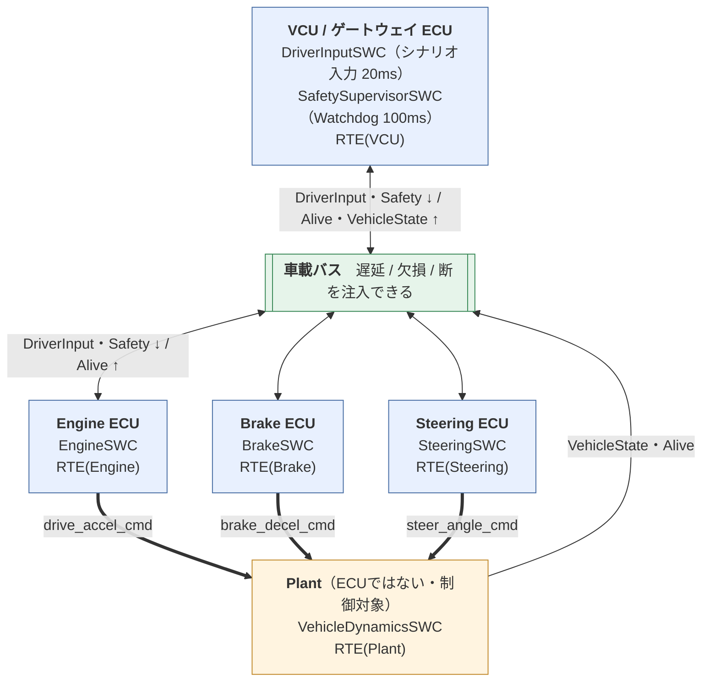
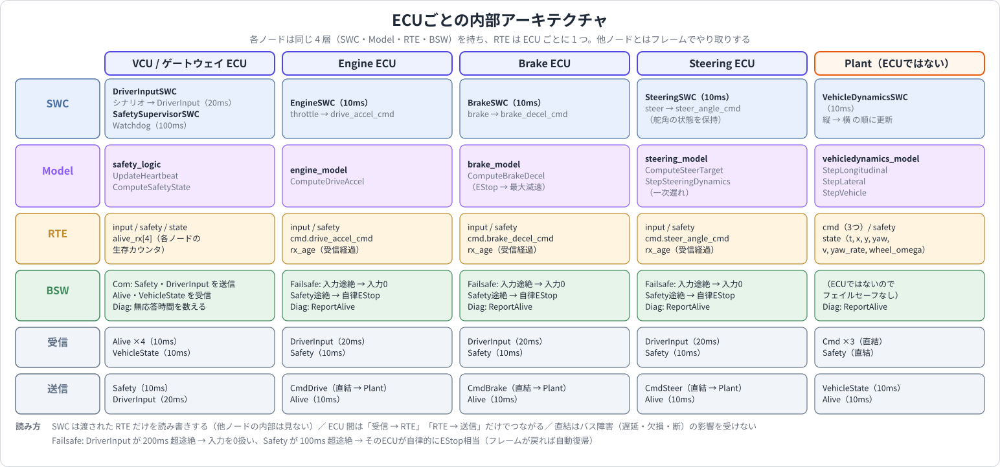
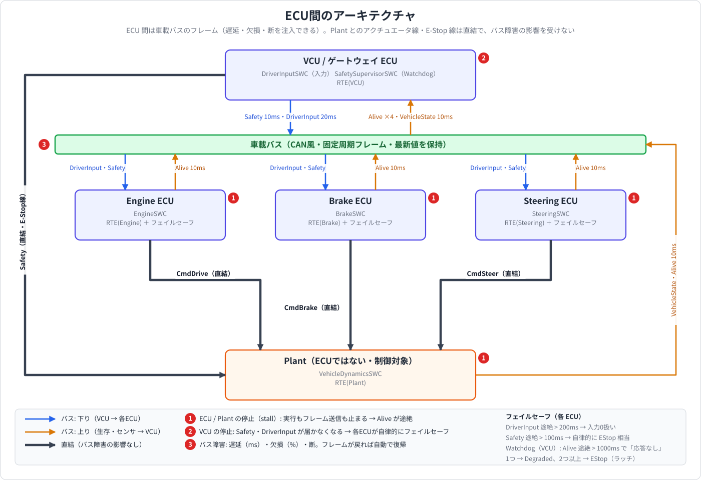
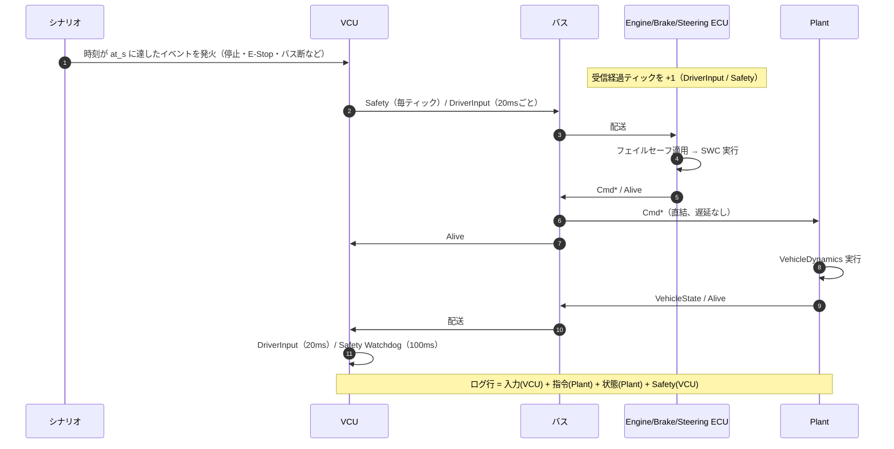
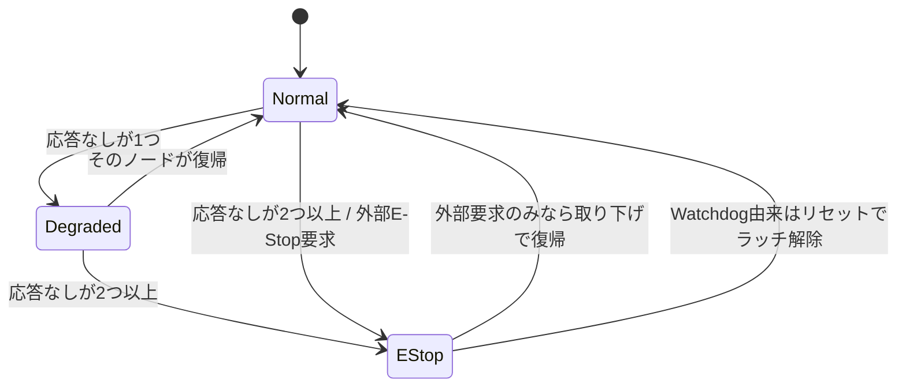
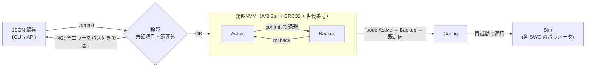
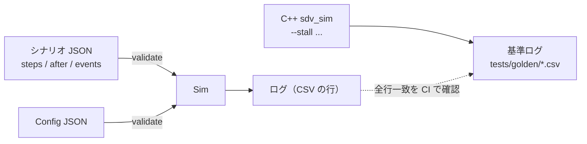
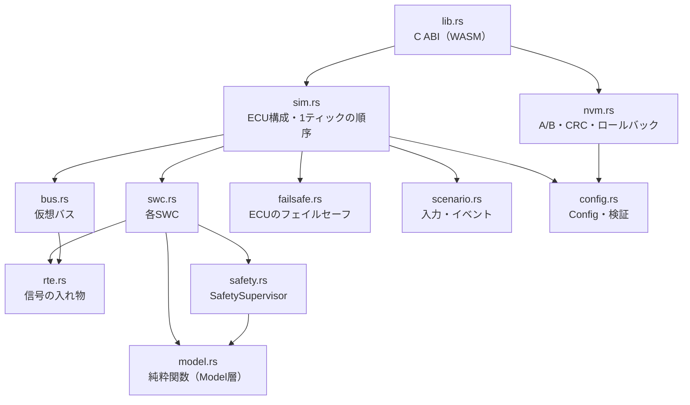
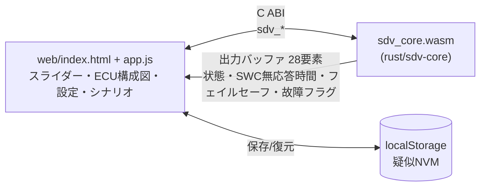
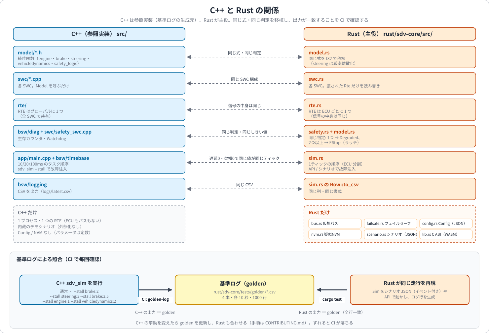

# ECU 構成・バス・Config/NVM アーキテクチャ（現行実装）

このドキュメントは、Rust 実装（`rust/sdv-core`）の**現在の**構成を図で示す。
設計判断の経緯は [ADR-0002（ECU分割）](../adr/ADR-0002-ecu-partitioning.md) と [ADR-0003（Config/NVM）](../adr/ADR-0003-config-nvm.md) を参照。
C++ 実装は参照実装として「ECUなし・1つの RTE」のまま残している（[01_architecture.md](01_architecture.md) はその構成）。

## 図の一覧

| 図 | 内容 |
|---|---|
| [ECU ごとの内部アーキテクチャ](img/ecu_internal.svg)（§1.1） | 各ノードの SWC・Model・RTE・BSW と送受信するフレーム |
| [ECU 間のアーキテクチャ](img/ecu_network.svg)（§1.2） | 車載バス・直結線・フレーム・故障注入点・フェイルセーフ |
| [C++ と Rust の関係](img/cpp_rust.svg)（§9） | モジュールの対応、Rust だけにあるもの、基準ログによる照合 |

（SVG 図は `tools/diagrams/gen_all.py` で生成。クリックすると拡大して見られる）

## 1. 全体構成

VCU・3つのECU・Plant（制御対象）が仮想バスでつながる。**RTE は ECU ごとに 1 つ**持つ。

- 太線（`==>`）は**直結**のアクチュエータ線。VCU の Safety も Plant へは直結（E-Stop 線）で届く。直結はバス障害（遅延・欠損・断）の影響を受けない
- VCU が停止すると Safety / DriverInput が届かなくなるが、各 ECU が自律的にフェイルセーフへ入る（§5）

### 1.1 ECU ごとの内部アーキテクチャ

どのノードも同じ 4 層（SWC・Model・RTE・BSW）を持つ。RTE は ECU ごとに 1 つで、SWC は渡された RTE だけを読み書きする。
ECU 間は「受信 → RTE」「RTE → 送信」だけでつながる。

### 1.2 ECU 間のアーキテクチャ

ECU 間は車載バスのフレーム（遅延・欠損・断を注入できる）。Plant とのアクチュエータ線・E-Stop 線は直結で、バス障害の影響を受けない。
図の ①〜③ は故障注入の入口（ECU/Plant の停止、VCU の停止、バス障害）。

## 2. バスマトリクス

| フレーム | 送信 | 受信 | 周期 | 内容 | リンク |
|---|---|---|---|---|---|
| DriverInput | VCU | Engine / Brake / Steering | 20 ms | throttle, brake, steer | バス |
| Safety | VCU | Engine / Brake / Steering | 10 ms | estop, system_state | バス |
| Safety | VCU | Plant | 10 ms | estop, system_state（E-Stop 時の強制減速モデル用） | 直結 |
| Alive | Engine / Brake / Steering / Plant | VCU | 10 ms | 生存カウンタ | バス |
| VehicleState | Plant | VCU | 10 ms | t, x, y, yaw, v, yaw_rate, wheel_omega | バス |
| CmdDrive / CmdBrake / CmdSteer | 各 ECU | Plant | 10 ms | drive_accel_cmd / brake_decel_cmd / steer_angle_cmd | 直結 |

## 3. 1 ティック（10ms）の実行順序

フレームは各段の間で配送される。遅延 0・欠損 0 のとき、1 プロセス版（C++）と同じ値が同じティックで見える
（そのため C++ の基準ログと全行一致する）。

## 4. 安全: Watchdog（VCU）と ECU のフェイルセーフ

### 4.1 Watchdog（VCU の Safety、100 ms 周期）

各ノードの生存カウンタが進まない時間を数え、`heartbeat_timeout_ms`（既定 1000 ms）を超えたら「応答なし」とする。

- Watchdog 由来の EStop は**ラッチ**され、ノードが復帰しても解除されない（リセットでのみ解除）。外部要求だけなら取り下げで Normal に戻る
- 監視対象は Engine / Brake / Steering の各 ECU と Plant

### 4.2 ECU の受信側フェイルセーフ

| 事象 | 動作 | 復帰 |
|---|---|---|
| DriverInput が 200 ms 超途絶（`failsafe.driver_timeout_ms`） | 入力を 0 として扱う | フレームが来れば自動 |
| Safety が 100 ms 超途絶（`failsafe.safety_timeout_ms`） | その ECU が自律的に EStop 相当（Engine 0、Brake 最大減速、Steering 0） | フレームが来れば自動 |

バス断・VCU 停止でも車は止まる。VCU 側の Watchdog は Alive の途絶を 1 秒後に検出して EStop（ラッチ）にする。

## 5. Config / NVM

- 更新は検証に通ったものだけ保存し、**再起動（boot）で有効**になる
- 壊れた Active は CRC と中身の検証で検出され、Backup から起動する。両方だめなら既定値
- ブラウザでは記憶装置に localStorage を使う（WASM 側は `NvmStorage` の読み書きをホストに任せる）

## 6. シナリオと再現性

- 同じ Config + 同じシナリオなら、毎回同じログになる（乱数は固定シードの疑似乱数のみ）
- C++ の基準ログ 4 本（通常 + 故障注入 3 パターン）を、Rust がシナリオ JSON で再現できることをテストしている

## 7. Rust クレートのモジュール構成

- Model 層（`model.rs`）は RTE に依存しない純粋関数。SWC は渡された `Rte` だけを読み書きするので、ECU ごとに別の `Rte` を持たせられる

## 8. ブラウザ（GUI）との関係

- シミュレーションの本体は WASM（Rust）。GUI は入力を渡し、出力バッファを描画するだけ
- GitHub Pages に公開（`.github/workflows/pages.yml`）。サーバー不要

## 9. C++ と Rust の関係

| 項目 | C++（`src/`） | Rust（`rust/sdv-core`） |
|---|---|---|
| 構成 | 1 プロセス・1 RTE | ECU ごとの RTE + 仮想バス |
| Watchdog | あり（SWC 4つの生存監視） | あり（同じ判定 + バス上の Alive） |
| 故障注入 | `sdv_sim --stall <swc>:<t>` | API / シナリオ JSON のイベント |
| Config / NVM / シナリオ | なし（定数・内蔵シナリオ） | あり |
| 役割 | 参照実装（基準ログの生成元） | 主役（GUI・拡張） |
